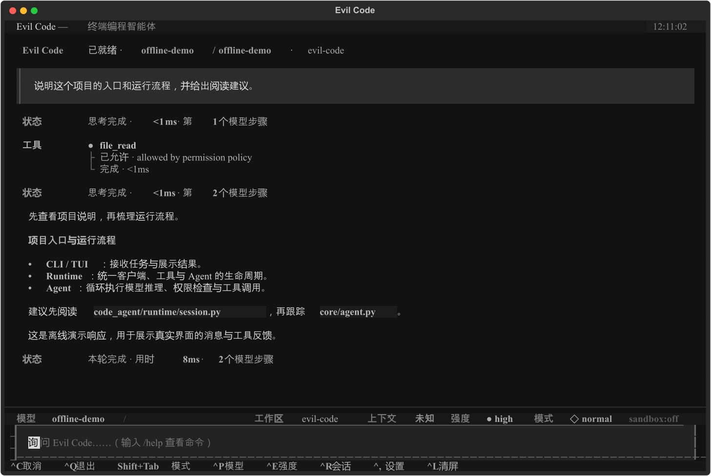
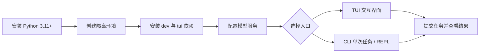
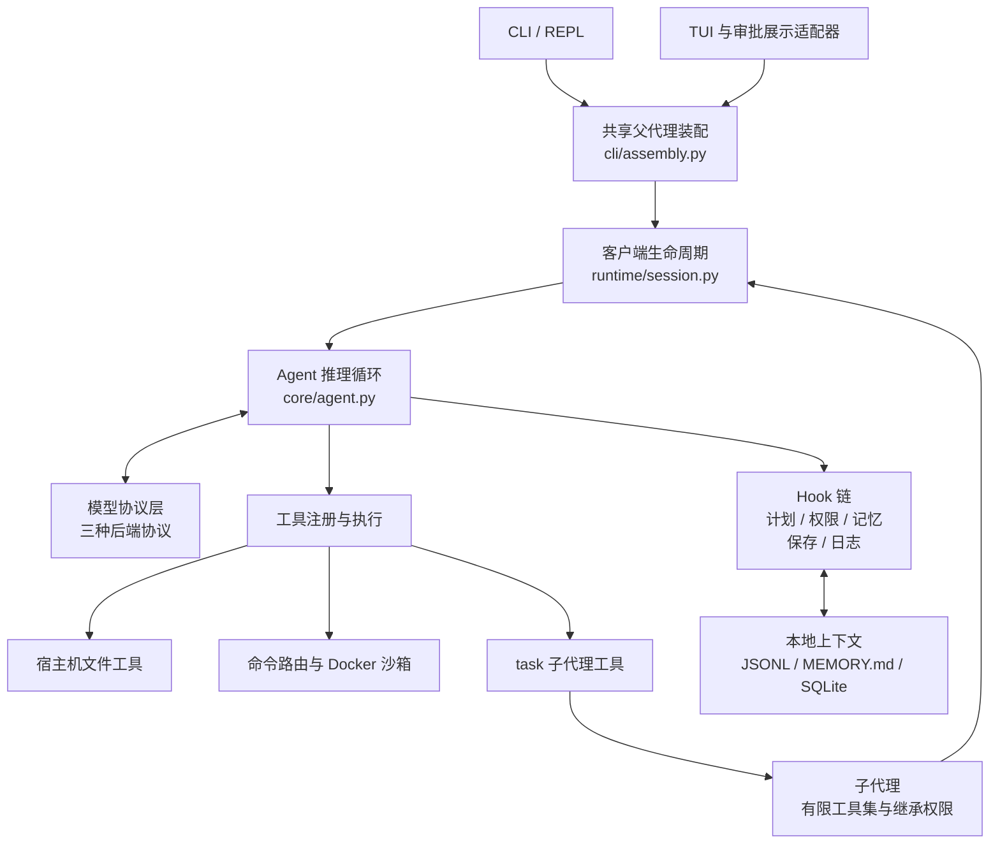
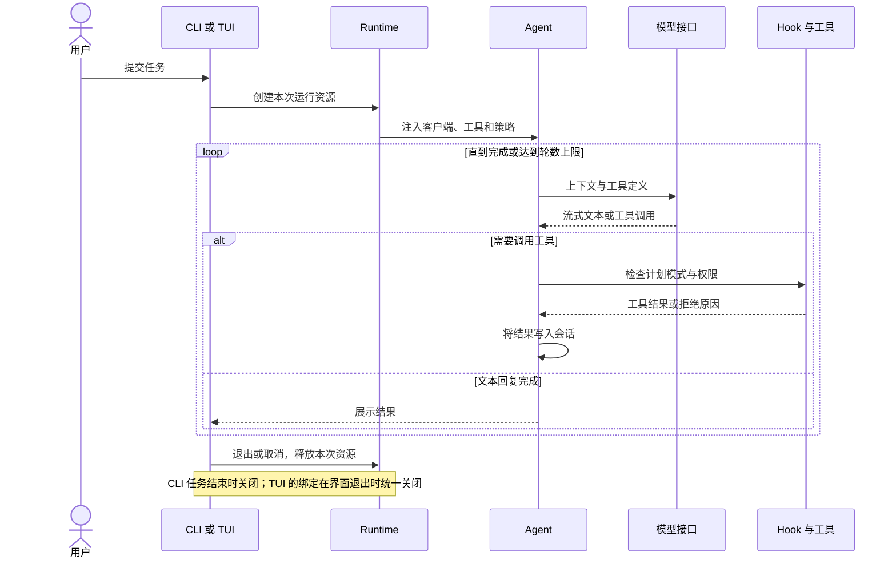
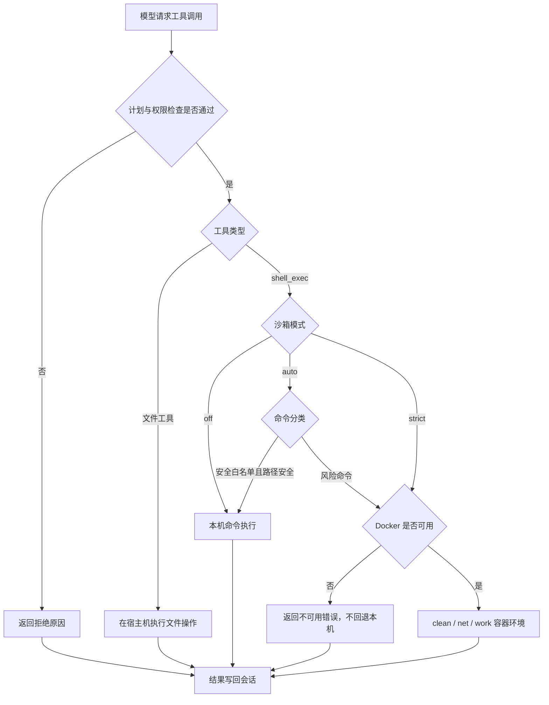

# Evil Code

**在终端里理解代码、调用工具，并把一次任务的上下文保留下来。**

Evil Code 是一个用 Python 编写的编码 Agent。你可以在全屏终端界面中与它协作，也可以把单次任务接入命令行脚本。它把模型回复、工具执行、权限检查、会话保存和上下文压缩串成一个可检查的工作过程。

`开发版本 0.1.0` · `Python 3.11+` · `Windows 自动验证` · `3 种模型协议`

[快速开始](#快速开始) · [界面与使用方式](#界面与使用方式) · [架构与运行流程](#架构与运行流程) · [权限与沙箱](#权限与沙箱) · [测试与改动留痕](#测试与改动留痕) · [常见问题](#常见问题)



*界面来自实际 Textual 程序的无终端截图。模型回复与文件读取结果使用离线演示数据，用于展示交互过程；没有调用真实模型服务。截图生成源见 [capture_readme.py](scripts/capture_readme.py)。*

## 能做什么

一个典型任务可以从“这个项目怎么运行”开始，逐步推进到查找相关文件、提出修改、执行工具、验证结果。对长任务，计划模式、待办列表和会话恢复帮助你继续跟踪上下文。

| 能力 | 实际用途 | 当前边界 |
| --- | --- | --- |
| 文件读取、搜索、编辑、写入与删除 | 理解代码、定位问题、修改实现 | 文件工具在宿主机运行，受权限策略约束 |
| 流式模型回复与工具循环 | 展示过程，让工具结果进入下一轮推理 | 需要自行配置可用的模型地址和名称 |
| CLI、REPL、TUI | 单次任务、持续对话、终端交互 | 三种入口共用 Agent；TUI 使用自己的审批展示 |
| 会话、记忆和上下文压缩 | 恢复对话、检索项目记忆、控制长上下文 | 压缩需要额外模型请求；跨会话记忆使用本地文件和索引 |
| 计划模式、待办和子代理 | 先分析再修改，委派范围明确的工作 | 子代理是隔离上下文，仍共享工作区；不提供任意递归代理 |
| Docker 命令沙箱 | 按命令风险选择隔离环境 | 它隔离 shell 命令，不等于整个应用的所有访问均被隔离 |
| Skills、插件和 MCP | 扩展任务指令和工具 | MCP 命令行参数目前连接单个服务，尚未接入 TUI 连接流程 |

项目仍处于开发阶段。界面中的模型预设不代表所有原生厂商协议均已实现；目前实际支持的协议是 **Chat Completions、Messages 和 Responses**。

## 快速开始

<!-- diagram: docs/diagrams/getting-started.mmd -->


[查看静态图](docs/assets/getting-started.svg)

### 1. 安装到独立环境

在项目根目录打开 Windows PowerShell：

```powershell
python --version
python -m venv .venv-dev
.\.venv-dev\Scripts\python.exe -m pip install -e ".[dev,tui]"
.\.venv-dev\Scripts\python.exe -m pip check
```

需要 Python **3.11 或以上**。这种写法无需激活虚拟环境，也不会改变系统 Python 的依赖。后面的示例可先定义一个便于输入的命令路径：

```powershell
$agent = ".\.venv-dev\Scripts\code-agent.exe"
```

| 安装选择 | 命令 | 用途 |
| --- | --- | --- |
| 命令行核心 | `python -m pip install -e .` | CLI、REPL |
| 终端界面 | `python -m pip install -e ".[tui]"` | 增加 Textual TUI |
| 开发与验证 | `python -m pip install -e ".[dev,tui]"` | 运行测试和覆盖率门禁 |

表中的 `python` 应指向你的隔离环境。若要在 Windows / Python 3.13.9 下复现已验证的依赖组合，可在安装命令后添加 `-c constraints-dev-windows.txt`。该文件是版本约束快照，不是跨平台兼容承诺。

### 2. 配置并启动终端界面

```powershell
& $agent --tui
```

首次没有可用密钥时，界面会进入模型服务配置。按服务实际情况填写接口协议、服务地址、模型名称和密钥。模型名称使用服务商提供的真实 ID，不需要沿用代码中的默认值。

只想先确认入口正常，可以运行：

```powershell
& $agent --help
```

Docker 是命令沙箱的运行条件，**查看界面、配置模型和普通文件操作不要求先启动 Docker**。当任务需要执行被路由到沙箱的命令时，再确认 Docker Desktop 已运行。

### 3. 运行第一个只读任务

TUI 中可以输入：

> 说明当前项目的入口、核心模块和测试方法。先读取相关文件，不修改代码。

单次命令也可以这样执行。服务地址、模型和密钥均为占位值，需要替换：

```powershell
$env:ANTHROPIC_API_KEY = "你的密钥"
& $agent "说明当前项目结构，不修改文件" --base-url "https://你的服务地址/v1" --provider chat_completions --model "你的模型名称"
```

已有本机配置可能优先于环境变量生效，详见 [模型配置与数据位置](#模型配置与数据位置)。

## 界面与使用方式

### TUI：适合持续协作

上方的演示图包含任务输入、工具执行反馈、流式回复和底部状态栏。状态栏展示当前模型、工作区、交互模式与沙箱状态，具体可用信息取决于当前会话和服务配置。

| 操作 | 快捷键 |
| --- | --- |
| 提交任务 | `Enter` |
| 取消当前任务 | `Esc` 或 `Ctrl+C` |
| 切换模型服务 | `Ctrl+P` |
| 查看会话 | `Ctrl+R` |
| 选择界面推理强度 | `Ctrl+E` |
| 切换交互模式 | `Shift+Tab` |
| 设置 | `Ctrl+,` |
| 清空当前显示 | `Ctrl+L` |
| 退出应用 | `Ctrl+Q` |

界面推理强度是应用层选项，不保证每个服务原生支持同样的模型参数；`ultracode` 当前折算为 `xhigh`，不能视为已完成的独立代理编排模式。

### CLI / REPL：适合脚本和小任务

无提示词时进入 REPL；传入提示词时运行一次任务。以下示例假设模型认证已经配置好：

```powershell
# 持续对话
& $agent

# 指定工作目录
& $agent "梳理入口与测试目录" --cwd "D:\path\to\project"

# 返回一个 JSON 对象，便于其他程序读取
& $agent "总结项目结构" --output-format json

# 逐行输出 JSON 事件
& $agent "总结项目结构" --output-format streaming-json

# 恢复当前项目最近的会话，或指定会话 ID
& $agent --continue
& $agent --resume "你的会话ID"

# 从计划模式开始
& $agent "先分析需要修改哪些文件" --plan
```

CLI 单次任务没有交互审批窗口。未预先获准的写入、删除和执行操作会被拒绝；需要修改代码时，可使用交互入口或配置范围明确的允许规则。

### 可以怎样描述任务

| 任务 | 示例 |
| --- | --- |
| 理解项目 | “从入口开始说明调用链，列出关键文件，不修改代码。” |
| 定位缺陷 | “读取失败测试及相关实现，解释原因，再给出最小修改。” |
| 可验证修改 | “先记录测试基线，修复这个问题，给出相同测试的前后结果。” |
| 审查改动 | “检查当前改动的行为变化和异常路径，标注尚未验证的部分。” |

这些是任务表达示例，实际执行质量取决于模型、上下文和可用工具。

## 模型配置与数据位置

### 三种协议

| `--provider` | 请求格式 | 使用时确认 |
| --- | --- | --- |
| `chat_completions` | Chat Completions | 服务是否支持工具调用及流式返回 |
| `messages` | Messages | 服务地址及 Bearer / API Key 认证方式是否匹配 |
| `responses` | Responses | 服务是否完整支持该协议；网页搜索工具还需服务端能力 |
| `auto` | 根据地址推断 | 第三方代理地址不明显时，建议显式指定协议 |

### 认证优先级

CLI 的读取顺序为：

**命令行参数 → `~/.evil-code/config.yaml` → 环境变量 → `~/.claude/settings.json` → OAuth 凭证。**

TUI 还会优先使用界面中选定的模型配置。`code-agent config set` 会同时更新原生配置和 `~/.claude/settings.json`；如果你在保留其他客户端的设置，可优先使用 TUI 的模型配置界面。

| 位置 | 保存内容 |
| --- | --- |
| `~/.evil-code/config.yaml` | CLI 原生服务与认证配置 |
| `~/.evil-code/traces/` | 开启 `--trace` 后的详细跟踪 |
| `~/.code-agent/` | TUI 配置、会话、记忆、日志等运行数据 |
| `<项目>/.code-agent/skills/` | 项目级 `SKILL.md` |
| `~/.code-agent/skills/` | 用户级 `SKILL.md` |
| `<项目>/.code-agent/sandbox.toml` | 项目沙箱配置 |
| `~/.code-agent/sandbox.toml` | 用户沙箱配置 |

`~` 表示当前用户目录。密钥和会话数据应保留在本机；仓库的忽略规则已覆盖常见本机配置，但分享跟踪日志前仍需检查其中的代码和工具内容。

新会话按规范化项目路径生成固定长度的目录哈希，避免 Windows 路径因 Base64 编码而继续膨胀。旧 Base64 布局仍支持读取、续写与最近会话查找。

## 架构与运行流程

### 模块怎样协作

<!-- diagram: docs/diagrams/architecture.mmd -->


[查看静态图](docs/assets/architecture.svg)

共享运行时负责资源的获取与释放；父代理装配集中在 `cli/assembly.py`；子代理保留独立上下文、有限工具集以及继承的权限规则。核心推理循环通过 Hook 接入上下文压缩、记忆、计划和保存能力。

### 一次任务如何推进

<!-- diagram: docs/diagrams/agent-loop.mmd -->


[查看静态图](docs/assets/agent-loop.svg)

工具执行失败或被拒绝时，原因作为工具结果进入会话，模型可以据此调整后续动作。正常退出、取消或装配失败都经过资源清理；TUI 切换产生的客户端目前在界面退出时统一关闭，尚未实现切换后立即回收。

## 权限与沙箱

### 两层约束怎样衔接

计划模式和权限判断必须允许工具继续执行，之后才进入对应的执行路径。CLI 与 TUI 的审批展示不同，不能把“有沙箱”理解为“所有操作都自动允许”。

<!-- diagram: docs/diagrams/sandbox-routing.mmd -->


[查看静态图](docs/assets/sandbox-routing.svg)

权限管理器首先检查显式拒绝规则，再检查 YOLO、显式允许规则、命令安全性及工具安全分类；需要询问时，交互入口请求审批，非交互入口拒绝。计划模式另外限制写入和删除，允许写入计划文件本身的特例仍保留。

### 沙箱模式与环境

| 模式 / 环境 | 行为 |
| --- | --- |
| `off` | shell 命令在本机执行，仍经过权限判断 |
| `auto`（默认） | 安全白名单且路径安全的命令本机执行，风险命令路由 Docker |
| `strict` | shell 命令强制进入沙箱 |
| `clean` | 只读工作区、无网络，用于默认隔离 |
| `net` | 只读工作区，提供网络访问路径 |
| `work` | 只读工作区，加可写环境卷，用于安装依赖等操作 |

优先级是 **`CODE_AGENT_SANDBOX` 环境变量 → `--sandbox` → 默认 `auto`**。`--sandbox` 对应 `strict`。

```powershell
$env:CODE_AGENT_SANDBOX = "strict"
& $agent "检查测试命令需要的环境"

# 查看本地沙箱管理帮助
& $agent sandbox --help
```

- CLI/TUI 中路由到沙箱的命令，在 Docker 不可用时返回错误，不自动改到宿主机执行。
- 文件工具仍作用于宿主机，不能用 shell 沙箱状态推断文件操作已获得隔离。
- 子代理不另开交互审批；未获允许的操作直接拒绝，也不能通过委派绕过计划模式。
- 出站代理允许白名单域名及子域名，只约束经过代理的流量；当前不提供所有容器直连流量的强制阻断。
- `draft` 子命令提供基于 Git worktree 的实验工作副本。使用前先查看 `& $agent draft --help`。

## 扩展工具

**Skills**：在项目或用户的 `.code-agent/skills/` 下放置带 frontmatter 的 `SKILL.md`，同名技能以项目级为先。可用技能会在启动时加载并提供给模型。

**MCP**：CLI/REPL 可以连接一个 stdio 或 HTTP 服务。下面的地址和脚本是占位示例：

```powershell
& $agent "查看服务提供的工具" --mcp-server "local=python path/to/server.py"
& $agent "查看服务提供的工具" --mcp-server "remote=https://你的服务地址/mcp"
```

MCP 工具在连接与发现后加入注册表，不能假定外部工具是只读的。真实服务的连通性、认证与兼容性需要单独验证。

## 测试与改动留痕

```powershell
.\.venv-dev\Scripts\python.exe -m pytest -q --tb=short
```

默认包含 **60% 总行覆盖率门禁**。以下是 2026-10-23 运行时优化批次的本机数据，环境为 Windows / Python 3.13.9；最新远程结果查看仓库的 [Actions](https://github.com/thehappysky/evil-code/actions)。

| 验证项 | 优化前 | 优化后 |
| --- | ---: | ---: |
| 全量通过 | 1081 | 1090 |
| 失败 / 错误 / 跳过 | 0 / 0 / 0 | 0 / 0 / 0 |
| 总行覆盖率 | 73.26% | 73.53% |
| 相同的资源释放检查 | 1 通过、6 失败 | 7 通过、0 失败 |
| 单次完整测试耗时 | 100.46 秒 | 99.17 秒 |

耗时是观测记录，不代表经过基准测试证明的性能提升。新检查确实先复现了客户端或 MCP 连接未关闭的问题，再验证修复；测试数量增加本身不等于功能变好。

后续每个逻辑批次都遵循：**记录基线 → 复现或定义目标 → 修改 → 验证 → 更新进度与证据 → 提交**。当前批次无效或出现回归时，先修正，再继续。

- 协作规则：[AGENTS.md](AGENTS.md)
- 本轮前后对比：[运行时与文档改版进度](progress/runtime-docs-2026-10-23.md)
- 原始输出及结构化结果：[证据目录](progress/evidence/2026-10-23/)
- 初始稳定性修复：[修复记录](progress/stabilization-2026-10-23.md)
- GitHub 首次上传与日常提交：[操作说明](GITHUB-UPLOAD.md)

自动测试使用模拟模型响应。真实模型、真实 Docker 与远程 MCP 完整任务不在本轮验证范围内；GitHub Actions 另外运行 Windows / Python 3.11 和 3.13 的安装及测试。

## 大模型与 Agent 评测

评测已接入真实 Agent 循环，使用 **16 项公开开发任务 + 2 项独立代码修复任务**。覆盖文件理解、结构化输出、多步骤编辑、只读约束、提示注入与异常恢复。按最终文件和结果判题，另外记录工具错误、越权尝试、重复稳定性、pass@k、P50/P95、Token 和估算成本。

| 从哪里开始 | 内容 |
| --- | --- |
| [评测手册与流程图](docs/evaluation.md) | 安装、真实调用、预算、判题口径、HTML 报告、人工复核与实验比较 |
| [建设方案](design-docs/LLM-Evaluation-Plan.md) | 分阶段目标、数据设计、指标、准入和后续规划 |
| [进度与前后数据](progress/evaluation-2026-10-26.md) | 每批软件测试、离线反例、真实模型结果与验证边界 |
| [开发集说明](evals/README.md) | 数据版本、公开答案、污染边界和评分局限 |

```powershell
# 在已安装项目的隔离环境内执行；每次使用新输出目录
python -m code_agent.evals validate
python -m code_agent.evals run --mode reference --repeats 2 --output .eval-runs/reference --fail-under 1
python -m code_agent.evals run --mode noop --repeats 2 --output .eval-runs/noop
# 查看输出目录中的 report.html、summary.json 和 trials.csv
```

离线参考执行 32/32、不操作反例 0/32，只证明评测流程能区分完成与未完成，**不代表大模型能力**。真实模型使用本机配置、显式价格表和请求前费用预留；原始轨迹默认留在本地，公开数据采用白名单汇总。代码题要求 Docker，环境不可用时记录基础设施问题，不在宿主机执行候选代码。当前结果仅代表四种文件工具的受限配置，未覆盖完整产品工具链。

## 项目结构与阅读顺序

```text
code_agent/
├── cli/           入口、父代理装配、子命令
├── tui/           终端界面、交互控制、展示适配器
├── runtime/       客户端与 Agent 的共享生命周期
├── evals/         任务执行、判题、指标、预算、报告与比较
├── core/          推理循环、会话、消息、计划状态
├── api/           模型协议、HTTP、SSE
├── tools/         工具定义、注册和执行
├── subagents/     子代理上下文、能力范围与协调
├── permission/    权限规则与判断
├── sandbox/       命令分类、容器、代理、工作副本
├── hooks/         记忆、保存、压缩、策略等生命周期接入
├── storage/       会话 JSONL 与恢复
├── memory/        MEMORY.md 和搜索索引
└── compaction/    上下文压缩与历史重组
```

推荐从 [runtime/session.py](code_agent/runtime/session.py) 理解资源边界，再读 [core/agent.py](code_agent/core/agent.py) 的推理循环，最后进入 [cli/assembly.py](code_agent/cli/assembly.py) 和 [tui/adapters.py](code_agent/tui/adapters.py) 查看入口如何接入。测试在 `tests/`，流程图源文件在 `docs/diagrams/`；`design-docs/` 与部分旧进度文档保留了历史方案，应结合日期阅读。

## 常见问题

**安装后提示找不到 `code-agent`？** 先用本文中的完整环境路径运行，确认项目装进了同一个虚拟环境。不要把系统 Python 和 `.venv-dev` 混用。

**PowerShell 不让激活环境？** 本文不要求运行激活脚本，直接调用 `.venv-dev/Scripts/` 下的可执行文件即可。

**换了环境变量，仍使用旧的模型配置？** 检查更高优先级的原生配置；TUI 还会使用当前选定的模型服务。

**为什么命令或文件修改被拒绝？** 查看工具反馈中的原因：可能是计划模式、拒绝规则、非交互审批限制或沙箱不可用。先确认任务需要的权限范围，再配置对应允许规则。

**测试全通过，是否说明真实模型一定可用？** 不能。测试验证已覆盖的代码行为，服务地址、模型名、认证、限流和 Docker 状态还需要真实环境确认。

**下一步优化什么？** 本轮先统一运行时与补齐留痕。后续再分别处理服务配置类型化、TUI 大文件拆分和更强的网络隔离，每一批继续提供前后验证数据。
