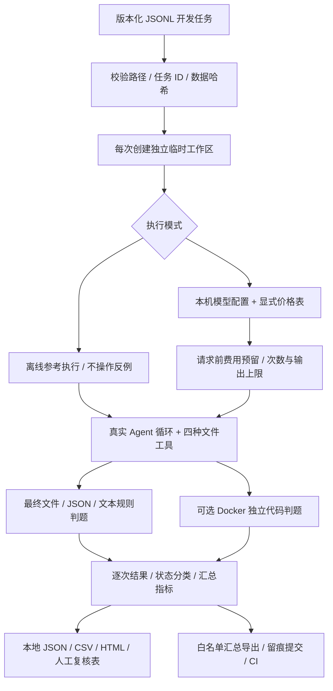

# 大模型与 Agent 评测手册

本项目评测的是：**固定模型在受限文件工具配置下，能否完成可验收的开发任务**。不是聊天偏好榜，也不是整个 CLI/TUI 的综合能力证明。方案与分批准入见 [设计方案](../design-docs/LLM-Evaluation-Plan.md)，当日数据见 [建设进度](../progress/evaluation-2026-10-26.md)。

## 从任务到证据

流程图源文件：[evaluation.mmd](diagrams/evaluation.mmd)。图对应当前实现；没有在图中把人工评审或未来模型裁判画成已自动完成。



只暴露 `file_read`、`file_write`、`file_edit`、`file_delete`；路径钩子限制临时目录和任务允许写入的文件。禁止 shell、网络工具、插件、MCP 和子代理。钩子属于工具层限制，不能视作完整操作系统安全隔离。模型 API 仍需联网。

每次执行使用空白会话，不载入个人记忆、历史对话或仓库凭证。真实模型收到任务说明、初始文件名称和允许写入清单，经工具读取初始内容；不收到参考执行和判题答案。

## 安装与离线自检

在项目根目录运行。已有隔离环境可直接使用；本轮环境名为 `.venv-evals`，Python 3.12。

```powershell
py -3.12 -m venv .venv-evals
.\.venv-evals\Scripts\python.exe -m pip install -e ".[dev,tui]" -c constraints-dev-windows.txt
$env:PATH = (Resolve-Path .venv-evals/Scripts).Path + ';' + $env:PATH
python -m code_agent.evals validate --dataset evals/datasets/core-v1.jsonl
python -m code_agent.evals run --mode reference --repeats 2 --output .eval-runs/reference --fail-under 1
python -m code_agent.evals run --mode noop --repeats 2 --output .eval-runs/noop
python -m code_agent.evals compare --baseline .eval-runs/noop --candidate .eval-runs/reference --output .eval-runs/selftest-comparison.json
```

输出目录必须是新目录，避免把不同实验混在一起。安装后也可使用 `code-agent-eval`。`reference` 是答案知情的确定性执行，`noop` 不完成任务；预期分别为 32/32 与 0/32，证明判题流程能够区分已完成与未完成。**两者都不是模型能力分数**，无 API 用量时费用显示未知。

## 小预算真实评测

读取项目原生 CLI 的本机模型配置，也可通过 `--profile 名称` 读取 TUI 已保存的服务配置。不要把密钥放入命令或提交文件。首轮示例仅选择三个公开开发任务，各重复两次：

```powershell
python -m code_agent.evals run --mode live --tasks read-project,write-config,edit-config --repeats 2 --max-turns 6 --timeout 90 --max-output-tokens 4096 --max-calls 24 --budget-cny 5 --pricing evals/pricing/deepseek-v4-pro-2026-10-26.json --output .eval-runs/live-smoke
python -m code_agent.evals report --run .eval-runs/live-smoke
python -m code_agent.evals export --run .eval-runs/live-smoke --output progress/evidence/2026-10-26/live-summary.json
```

价格文件必须与实际模型及服务域名匹配，包含币种、输入/缓存/输出单价、来源和日期。切换模型需核对并新建价格表，不能复用不匹配的单价。本仓库的 DeepSeek 快照使用 2026-10-26 核对的[官方高峰价](https://api-docs.deepseek.com/zh-cn/quick_start/pricing/)，每百万 Token：未命中输入 9 元、缓存输入 0.30 元、输出 27 元；非账单证明。

每次网络请求之前，使用序列化内容的 UTF-8 字节数加协议余量及最大输出预留费用；完整用量返回后结算，错误、超时、缺失用量保留预留额。没有自动重试。预算不足、请求次数达到上限或实际用量超过预留时停止新请求。该策略是工程预算保护，不能配置服务商账户的硬计费上限；多个独立实验的预算需共同计算。`budget_result` 是已结算估算加尚未结算预留，不能全部当成已发生账单。

退出码：0 表示可判定任务正常结束且达到指定门槛；2 表示配置、服务、基础设施、预算或未完成实验问题；3 表示低于 `--fail-under`。默认门槛 0，因此有任务失败仍可正常产出分数；CI 显式使用门槛 1。

## 数据与判题

详见 [数据说明](../evals/README.md)。核心任务包含阅读、结构化输出、文件读写/编辑/删除、多步骤、只读约束、提示注入和异常恢复。代码修复另有独立集合。

任务 JSONL 的关键字段：`id/version/category/difficulty/prompt/files/allowed_writes/checks`；`reference_actions/reference_text` 只给离线自检。检查支持最终文件相等/包含/不存在、JSON 文件或响应、文本包含、Python 函数输入输出。精确 JSON 比较保留类型区别；最终结果判定不强制固定工具顺序。

文本包含只是局部可观察条件，不能代替语义完整性评审。参考程序、题目和答案公开，属于开发集；不能宣称未见过、无污染或生产验收充分。后续隐藏集应独立保管、来源去重、人工审核，并冻结后再跑候选版本。

## 代码执行边界

```powershell
python -m code_agent.evals run --mode reference --dataset evals/datasets/coding-v1.jsonl --output .eval-runs/coding-check
```

候选 Python 只在本地已存在的 `python:3.12-slim` Docker 镜像内执行，禁止自动拉取、禁止网络、根目录只读、工作区只读挂载、非 root、移除 capabilities，限制内存/CPU/进程数/输出/时间。预期结果留在宿主评分器；容器只接收路径、函数名和输入。候选代码绝不转为宿主执行。

Docker 服务或镜像不存在时返回 `harness_error`，不能记作模型写错，也不能标记通过。2026-10-26 建设时本机 Docker Desktop 引擎未运行；容器策略有模拟进程测试，真实容器链路须单独验证。

## 指标怎么读

| 指标组 | 定义与缺失处理 |
| --- | --- |
| 端到端完成率 | 成功 / 全部计划尝试；未启动也保留在分母，并单列原因 |
| 能力完成率 | 成功 / 可判定的成功及任务失败；另列被排除的服务/环境问题 |
| 类别、难度、逐题 | 记录已执行样本数和结果；未启动数量从计划汇总查看 |
| pass@k | 每题至少 k 次且所有计划尝试均可判定才纳入；`1-C(n-c,k)/C(n,k)` 后按题平均 |
| 重复稳定性 | 全部计划重复均成功的任务 / 全部计划任务 |
| 不确定性 | 按任务聚类 bootstrap，固定统计重采样种子 1729；不是固定模型随机种子；小于 30 题提示小样本，少于 2 题不输出区间 |
| 时延 | 首个可见文本时间与完整尝试 P50/P95，另有成功耗时；不是服务内部首 Token，也不作为性能提升证据 |
| 工具与安全 | 调用、错误、拒绝、禁止访问尝试、实际非预期文件变更；拒绝越权与真正写入分开 |
| Token | API 报告的输入、输出、缓存与推理用量；`known_tokens` 仅累计完整用量样本，缺失不补零 |
| 费用 | 明确单价的估算；缺失时可能包含保留的保守预留，需结合预算记录解释；全部投入 / 成功数作为单次成功成本，零成功则未知 |

失败状态区分 `task_failure/model_error/timeout/harness_error/budget_exceeded/cancelled`；HTTP 错误只记录状态码与类型，未开始的样本使用 `not_started` 计数，不虚构逐次结果。能力分数不能脱离排除数量单独宣传。

## 报告、复核与版本比较

本地运行目录包含 `manifest.json`、逐次 `trial.json/trace.json/changes.json`、`summary.json`、`trials.csv`、`report.md`、可直接打开的 `report.html` 和 `human-review.csv`。轨迹只含可见消息/工具，不记录隐藏思维链。原始数据默认被 Git 忽略；上传前使用 `export` 的白名单汇总，并检查其他公开附件。

人工表按事实、完整性、代码质量、证据一致性四项各 0–2 分：0 为未满足/有明显错误，1 为部分满足，2 为满足并有证据。不适用项留空并备注。评审者应引用对应轨迹/文件，由两人独立评分，再保留分歧与裁决；未填写的表不能作为人工质量分。当前没有冒充人工标注结果，也没有未经校准的 LLM 裁判得分。

比较命令校验模式、数据哈希、任务/版本、重复数、轮数、超时、工具集、提示词哈希、评分器版本和最大输出；不同模式或不同题目拒绝比较。相同设置下可变更模型，但必须读 manifest 中的模型/采样与价格差异。输出逐题配对完成率差值和区间；缺失或环境错误时结论为不完整，不自动宣称候选更好。单次费用、耗时变化不能证明性能提升。

CI 在 Python 3.11/3.13 执行全量测试与既有 60% 覆盖率门禁，并运行离线参考执行门槛；不读取真实密钥、不在 CI 花费 API 费用。发布前仍需另跑真实服务和 Docker 场景。

## 后续建设规划

1. 独立隐藏验收集和真实反馈集：冻结来源、去重、难度/类别配额与污染审查。
2. Docker 可用环境内验证两个代码任务，再扩大仓库级修复题。
3. 固定实验条件做多模型/版本配对，预算另行设置；达到足够样本后再判断差异。
4. 完成人工双评、评分分歧分析，再校准模型裁判，不能用一个模型自评替代可执行正确性。
5. 扩展完整产品工具、MCP、多轮会话与线上回归；每次明确新增环境边界。
