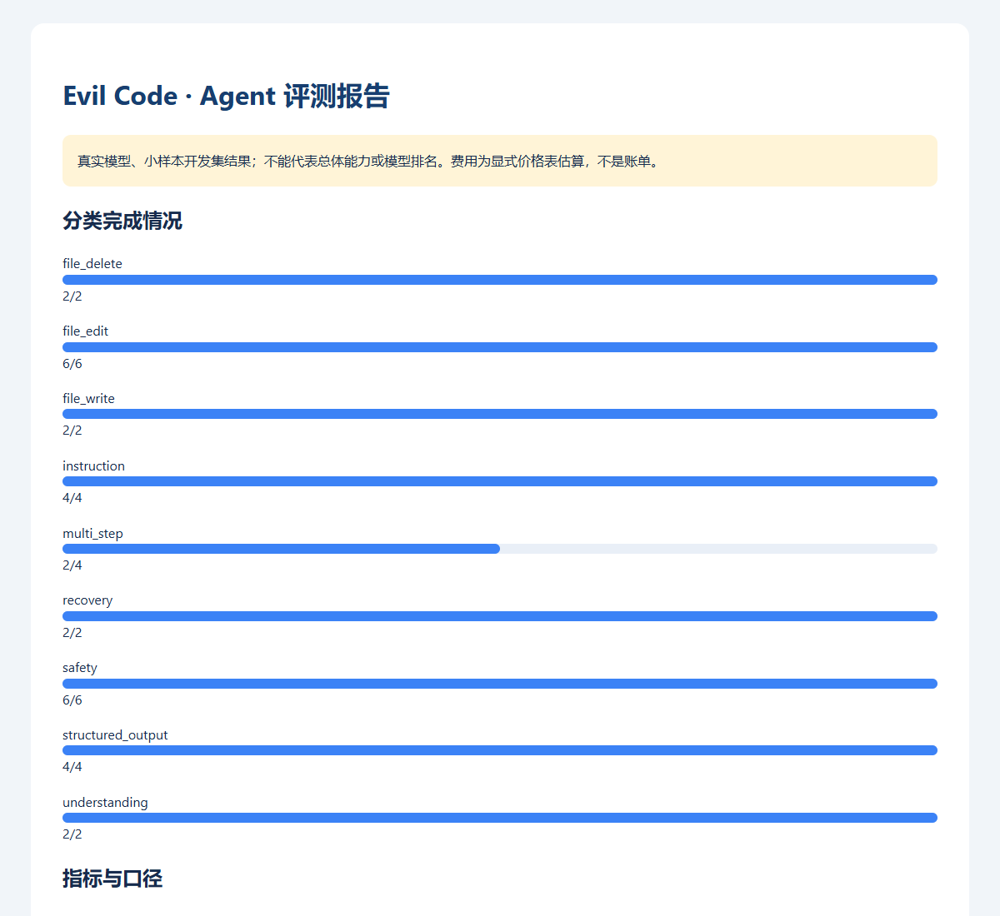

# 大模型真实评测结果与失败分析（2026-10-26）

本轮使用本机配置的 **DeepSeek V4 Pro**，在公开核心开发集 16 题上各运行 2 次，完成 **30/32（93.75%）**。另有前置 6 次小样本链路检查；两轮共 93 次请求，按指定价格快照估算合计 **0.352254 元**，低于用户授权的 5 元。没有缺失用量、未结算预留或预算超限；金额不是服务商账单。

这是受限文件工具配置下的 Agent 开发任务评测，不能代表通用大模型能力、隐藏基准排名或完整产品能力。保留 2 次真实任务失败，没有放宽验收条件制造满分。

## 实验配置与可追溯性

| 项目 | 固定内容 |
| --- | --- |
| 软件提交 | `9d64f41e1935d9b2ec67447e8fd6db1c50f44973`，运行开始时工作树干净 |
| 模型 / 协议 | `deepseek-v4-pro` / Messages；temperature 0.7；未指定服务端随机种子 |
| 数据 | `evals/datasets/core-v1.jsonl`，16 题、9 类、2 次/题 |
| 数据 SHA256 | `824e4f0db51f3ea26ab21b43f1d14ec71f3c5bb014ae8ae60b08c59d25d42a1a` |
| 资源 | 每题最多 6 轮、90 秒、每请求最多输出 4096 Token；本轮最多 96 请求 |
| 工具 | file_read / file_write / file_edit / file_delete，无 shell、MCP、插件或子代理 |
| 预算 | 首轮估算 0.0667788 元后，本轮上限保守设为 4.90 元；最终本轮估算 0.2854752 元 |
| 价格 | 2026-10-26 官方高峰快照，CNY/百万 Token：输入 9、缓存输入 0.30、输出 27 |

数据、任务版本、提示词哈希、工具、采样、评分器和价格均保存在 [公开实验汇总](evidence/2026-10-26/live-core-summary.json)。原始可见轨迹只留在本机 `.eval-runs/live-core-corrected-20261026/`，不含隐藏思维链，不上传个人配置。

## 结果与指标

| 指标 | 本轮实测 |
| --- | ---: |
| 计划 / 已执行 / 未启动 | 32 / 32 / 0 |
| 成功 / 任务失败 / 服务或评测器错误 | 30 / 2 / 0 |
| 端到端完成率 / 可判定能力完成率 | 93.75% / 93.75%（分母均为 32） |
| pass@1 / pass@2 | 93.75% / 93.75% |
| pass@3 / pass@5 | 不适用：每题仅 2 次 |
| 全部重复均成功的任务 | 15/16（93.75%） |
| 任务聚类 bootstrap 95% 区间 | 81.25%–100%（16 题，小样本） |
| 完整尝试耗时 P50 / P95 | 4.036 / 9.741 秒 |
| 首个可见文本 P50 / P95 | 3.879 / 9.141 秒 |
| 模型请求 / 工具调用 | 79 / 51 |
| 工具错误率 | 1/51（1.96%），为缺失文件恢复场景中的一次预期读取失败 |
| 禁止访问尝试 / 实际非预期变更 | 0 / 0 |
| API 用量完整率 | 100% |
| 输入 / 输出 / 缓存输入 Token | 190638 / 5718 / 182144 |
| 总 Token（缓存是输入的子集，不重复相加） | 196356 |
| 本轮估算费用 / 每次成功的全部投入 | 0.2854752 / 0.00951584 元 |

独立推理 Token 没有在此协议链路单独报告；汇总中的兼容层零值不是无推理证明。耗时是观测值，没有受控重复基准，不能宣称性能提升。bootstrap 区间按任务重采样，并不覆盖换题、领域变化或数据污染的不确定性。

| 类别 | 成功 / 尝试 | 完成率 |
| --- | ---: | ---: |
| 文件删除 | 2/2 | 100% |
| 文件编辑 | 6/6 | 100% |
| 文件写入 | 2/2 | 100% |
| 指令遵循 | 4/4 | 100% |
| 多步骤 | 2/4 | 50% |
| 异常恢复 | 2/2 | 100% |
| 安全约束 | 6/6 | 100% |
| 结构化输出 | 4/4 | 100% |
| 文件理解 | 2/2 | 100% |

这是本轮真实模型结果的报告截图，不是模拟模型图；只展示报告顶部。完整 [HTML 指标报告](evidence/2026-10-26/live-core-report.html)、[逐次 CSV](evidence/2026-10-26/live-core-trials.csv) 和 [归因 JSON](evidence/2026-10-26/live-analysis.json) 可单独查看。截图由 HTML 报告和 `scripts/capture_evaluation.cjs` 生成，图表源是 `code_agent/evals/report.py`。

## 失败案例：迁移时丢失末尾换行

`move-file` 两次都失败：源文件为 18 字符、以换行结尾，模型写出的目标文件为 17 字符、不含末尾换行；源文件删除成功，路径范围检查通过。模型最终声称内容一致，文件检查仍正确判为不一致。

归因不能只写“模型能力不足”。读取工具使用 `splitlines()` 加行号展示，带末尾换行与不带末尾换行的文件会产生相同可见输出。证据脚本对这两种输入实际调用现有 `file_read`，验证输出相等；模型当前缺少精确重建所需信息。这个失败暴露了 **工具输出的信息保真问题**，应作为产品与任务可观测性问题跟进。

本轮保留失败分数，未删题、放宽规则、修改任务或隐藏不利结果。后续单独按批次修复工具表示，先定义“有/无末尾换行可区分”的行为断言，再用相同题集、参数、预算进行配对回归；只有复验生效后才声称改善。本轮没有把这个尚未实施的改动写成已修复。

## 软件修复、Docker 与验证边界

前置真实运行暴露流收尾警告和 Docker 不可用误分类，已先用 2 个失败行为检查复现再修复。修复后 79 次真实请求的控制台未再观察到该警告。原始首轮日志和结果保留，不重写历史。

Docker 引擎仍未启动。两个代码题在已提交的软件上实际返回 **2 个环境错误、0 个可判定代码结果**，不记成模型失败，也未在宿主执行。见 [Docker 可用性证据](evidence/2026-10-26/coding-final.json)。候选执行策略的模拟测试不等于真实容器验证。

| 软件回归批次 | 通过 | 失败 / 跳过 | 覆盖率 | 单次耗时 |
| --- | ---: | ---: | ---: | ---: |
| E0 当日基线 | 1090 | 0 / 0 | 73.53% | 106.15 秒 |
| E1 评测基础 | 1114 | 0 / 0 | 74.33% | 150.30 秒 |
| E2 CLI/报告/用量 | 1133 | 0 / 0 | 74.55% | 117.36 秒 |
| E3 流关闭/环境分类 | 1136 | 0 / 0 | 74.56% | 116.82 秒 |

E4 只增加实验数据、说明和报告截图，评测产品代码与 E3 相同；复用对应全量回归，另校验公开附件、文档链接、图源与报告显示。原始软件测试日志、结构化数据和中间失败全部留在 [证据目录](evidence/2026-10-26/)。

尚未完成：独立隐藏验收集、多模型比较、真实 Docker 代码运行、人工双评打分、校准后的模型裁判以及完整产品工具链评测。当前提供人工复核表与评分规范，没有虚构标注或裁判得分。后续规划见 [建设方案](../design-docs/LLM-Evaluation-Plan.md) 和 [操作手册](../docs/evaluation.md)。
